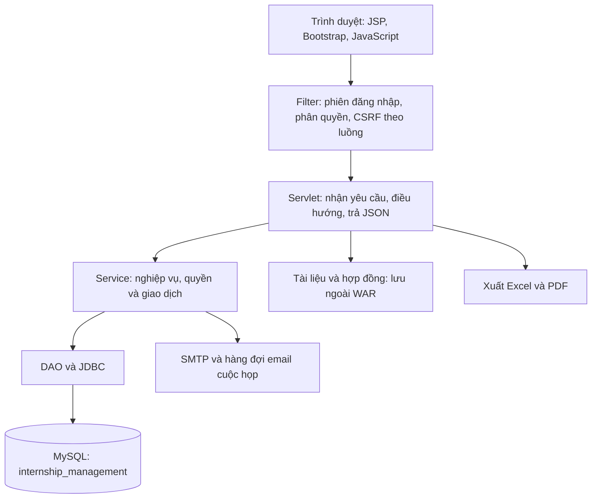

# Internship Management System

### Hệ thống quản lý thực tập sinh

Ứng dụng web hỗ trợ doanh nghiệp quản lý quá trình thực tập: từ đăng ký tài khoản, nộp hồ sơ và ứng tuyển đến ghi danh chương trình, phân công mentor, theo dõi công việc, chấm công, báo cáo và đánh giá cuối kỳ.

Dự án được xây dựng theo mô hình **MVC với Java Servlet/JSP**, đóng gói thành **WAR** và triển khai trên **Apache Tomcat 10.1**. Bốn vai trò sử dụng là **ADMIN, HR, MENTOR và INTERN**.

| Nền tảng | Công nghệ |
| --- | --- |
| Backend | Java 21, Jakarta Servlet 6.0, JDBC |
| Giao diện | JSP 3.1, JSTL 3, Bootstrap 5.3.3, JavaScript |
| Cơ sở dữ liệu | MySQL 8.0+, InnoDB, UTF-8 (`utf8mb4`) |
| Máy chủ ứng dụng | Apache Tomcat 10.1 |
| Build và kiểm thử | Maven, JUnit 5, Node.js cho các bài kiểm tra JavaScript |
| Tiện ích | BCrypt, Jakarta Mail, Apache POI, Apache PDFBox |

> `main` là nhánh bàn giao; `develop` là nhánh tích hợp. Các thay đổi tiếp theo được thực hiện trên nhánh riêng và review qua Pull Request. Thông tin kết nối, mật khẩu và dữ liệu thực tế được cấu hình riêng cho từng máy.

## Mục lục

- [Chức năng theo vai trò](#chuc-nang)
- [Luồng nghiệp vụ chính](#nghiep-vu)
- [Kiến trúc và mã nguồn](#kien-truc)
- [Yêu cầu môi trường](#moi-truong)
- [Cài đặt cơ sở dữ liệu](#co-so-du-lieu)
- [Cấu hình ứng dụng](#cau-hinh)
- [Build và triển khai](#trien-khai)
- [Tài khoản phát triển](#tai-khoan)
- [Kiểm thử và nghiệm thu](#kiem-thu)
- [Quy trình Git](#git)
- [Xử lý lỗi thường gặp](#xu-ly-loi)
- [Tài liệu kỹ thuật](#tai-lieu)

<a id="chuc-nang"></a>
## 1. Chức năng theo vai trò

| Vai trò | Các chức năng chính |
| --- | --- |
| **ADMIN** | Quản lý tài khoản, trạng thái và vai trò; tra cứu nhật ký thao tác; sử dụng các phân hệ HR theo quyền được cấp. |
| **HR** | Quản lý hồ sơ, đơn ứng tuyển, tài liệu và hợp đồng; quản lý phòng ban, chương trình và mentor; ghi danh, phân công/điều chuyển mentor; lập lịch làm việc, duyệt nghỉ phép; theo dõi chấm công, phụ cấp và yêu cầu hỗ trợ; quản lý lịch họp; xem thống kê và xuất báo cáo. |
| **MENTOR** | Xem thực tập sinh được phân công; tạo/giao nhiệm vụ, theo dõi tiến độ; đọc và phản hồi báo cáo tuần; đánh giá kỹ năng, thái độ; quản lý cuộc họp trong phạm vi phụ trách. |
| **INTERN** | Đăng ký và cập nhật hồ sơ; nộp đơn, tải tài liệu, xem/xác nhận hợp đồng; xem ghi danh và mentor; xem lịch, xin nghỉ, chấm công; cập nhật công việc, nộp báo cáo tuần; xem đánh giá, phụ cấp, phản hồi hỗ trợ và thông báo. |

Các tiện ích giao diện gồm chuyển sáng/tối, hiện/ẩn mật khẩu, đổi mật khẩu, chọn thực tập sinh bằng email và gợi ý email khi nhập. Gợi ý tìm theo chuỗi không phân biệt hoa/thường, có thể chọn bằng chuột hoặc bàn phím.

**Email dùng để tìm người.** Khi một email có nhiều đợt ghi danh trong lịch sử, người thao tác phải chọn đúng đợt/chương trình. Hệ thống vẫn dùng `enrollment_id` làm khóa liên kết nội bộ. Không yêu cầu địa chỉ phải thuộc riêng miền Gmail.

<a id="nghiep-vu"></a>
## 2. Luồng nghiệp vụ chính

1. Thực tập sinh đăng ký tài khoản, hoàn thiện hồ sơ, tải tài liệu và nộp đơn ứng tuyển.
2. HR kiểm tra hồ sơ/tài liệu, duyệt hoặc từ chối đơn; chuẩn bị hợp đồng để thực tập sinh xác nhận.
3. HR chọn đơn đã duyệt để ghi danh vào chương trình và phân công mentor.
4. Trong thời gian thực tập, HR quản lý lịch, nghỉ phép, chấm công và phụ cấp; mentor giao việc, phản hồi báo cáo và tổ chức họp.
5. Thực tập sinh cập nhật tiến độ, nộp báo cáo tuần và theo dõi kết quả đánh giá.
6. HR xem tổng hợp, xuất Excel/PDF và xử lý kết thúc/hủy ghi danh theo nghiệp vụ.

Các quy tắc cần lưu ý:

- Lưu hồ sơ, nộp đơn, duyệt đơn và ghi danh là các thao tác riêng. Hồ sơ `ACTIVE` không đồng nghĩa đã được ghi danh.
- Mỗi thực tập sinh có tối đa một ghi danh `ACTIVE`; mỗi ghi danh có tối đa một phân công mentor đang hiệu lực.
- Quyền thao tác được giới hạn theo vai trò, chủ sở hữu, người phụ trách và trạng thái ghi danh.
- Báo cáo đã nộp không được sửa như bản nháp. Lịch sử tiến độ, phản hồi và đánh giá được giữ để tra cứu.
- Đánh giá mới dùng hai tiêu chí kỹ năng/thái độ từ 1 đến 5; điểm cũ theo thang 100 được giữ riêng, không tự quy đổi.
- Ca làm nằm trong khoảng nghỉ đã duyệt có thể hiển thị “Đã duyệt nghỉ”, kể cả khi ca được tạo sau quyết định duyệt. Cần đối chiếu đúng người và khoảng ngày.
- Thời gian nghiệp vụ hiển thị theo `Asia/Ho_Chi_Minh`; không sửa dữ liệu bằng cách cộng cứng giờ vào database.

<a id="kien-truc"></a>
## 3. Kiến trúc và tổ chức mã nguồn



| Thư mục/tệp | Nội dung |
| --- | --- |
| `src/main/java/com/internship/controller/` | Servlet cho các trang, biểu mẫu và API. |
| `src/main/java/com/internship/filter/` | Kiểm soát truy cập và các bộ lọc dùng chung. |
| `src/main/java/com/internship/service/` | Nghiệp vụ, thông báo và xuất báo cáo. |
| `src/main/java/com/internship/dao/` | Truy vấn và cập nhật cơ sở dữ liệu. |
| `src/main/java/com/internship/model/` | Các mô hình dữ liệu. |
| `src/main/java/com/internship/util/` | Kết nối DB, mật khẩu, CSRF, thời gian và lưu tệp. |
| `src/main/resources/` | Mẫu cấu hình DB/mail; bản thật chỉ lưu local. |
| `src/main/webapp/WEB-INF/views/` | JSP được Servlet điều hướng tới. |
| `src/main/webapp/assets/` | CSS và JavaScript. |
| `src/main/webapp/hr/`, `intern/` | Các trang và điểm vào giao diện còn được sử dụng. |
| `database/`, `sql/` | Schema, migration và dữ liệu QA mẫu. |
| `src/test/`, `scripts/` | Kiểm thử Java/JavaScript, công cụ backup và xác minh. |
| `docs/` | Hợp đồng API, hướng dẫn sử dụng và vận hành từng phân hệ. |
| `pom.xml` | Phiên bản thư viện, Java và cách đóng gói WAR. |

Nhóm phát triển theo các phần việc BE1–BE4 và FE1–FE3. Xác thực, session, cấu hình kết nối và quy ước dùng chung được giữ thống nhất khi tích hợp chức năng/giao diện.

<a id="moi-truong"></a>
## 4. Yêu cầu môi trường

| Thành phần | Yêu cầu/hướng dẫn |
| --- | --- |
| JDK | **Java 21** là phiên bản build đã chốt trong `pom.xml`. `JAVA_HOME` trỏ tới thư mục JDK, không phải `bin`. |
| Maven | Maven 3.8.7 hoặc 3.9.x đã được sử dụng trong quá trình kiểm thử. |
| Tomcat | **10.1.x**, tương thích Jakarta Servlet 6.0. Không dùng Tomcat 9 cho WAR này. |
| Database | MySQL 8.0+ là nền tảng schema tham chiếu. XAMPP/MariaDB cần đối chiếu schema và kiểm thử trên chính máy triển khai. |
| Node.js | Dùng để chạy kiểm tra JavaScript, không phải máy chủ ứng dụng. Nhóm đã sử dụng Node.js 24. |
| Python 3, Docker | Dùng cho backup và một số kiểm thử DB độc lập; không bắt buộc chỉ để chạy WAR với DB có sẵn. |
| Font PDF | Font TTF hỗ trợ tiếng Việt, chọn bằng `-Dbe4.pdf.font=...`. |

Kiểm tra công cụ:

```bash
java -version
mvn -version
node --version
git --version
```

Giao diện hiện tải Bootstrap, Bootstrap Icons và font từ CDN. Khi demo cần có mạng để tải các tài nguyên này, hoặc chuẩn bị phương án lưu tài nguyên nội bộ riêng.

<a id="co-so-du-lieu"></a>
## 5. Cài đặt cơ sở dữ liệu

### 5.1. Cài mới trên database trống

```bash
git clone https://github.com/hscret7/internship-management-system.git
cd internship-management-system
git switch main
```

Kết nối MySQL bằng tài khoản có quyền tạo schema. Thay `3306` bằng cổng DB thực tế:

```bash
mysql --host=127.0.0.1 --port=3306 --user=YOUR_DB_ADMIN --password --default-character-set=utf8mb4
```

Trong MySQL CLI, chạy lần lượt các lệnh dưới đây. Đường dẫn tương đối được tính từ thư mục dự án nơi mở CLI. Nếu dùng Workbench/phpMyAdmin, mở và chạy từng tệp theo cùng thứ tự.

```sql
SOURCE database/schema.sql;
SOURCE sql/schema_be2.sql;
SOURCE sql/schema_be3.sql;
SOURCE sql/schema_be4.sql;
SOURCE sql/schema_be2_sprint3.sql;
SOURCE sql/schema_be3_schedule_leave.sql;
SOURCE sql/schema_be3_lifecycle.sql;
SOURCE sql/schema_be4_sprint3.sql;
SOURCE sql/schema_be4_attendance_export.sql;
USE internship_management;
SOURCE sql/schema_be1_audit.sql;
SOURCE sql/schema_be1_meetings.sql;
SOURCE sql/schema_be1_meeting_notifications.sql;
SOURCE sql/schema_be1_inapp_notifications.sql;
SHOW TABLES;
```

Các script dùng tên database `internship_management`. Không chỉ sửa tên trong JDBC URL rồi mặc định các script cũng sẽ tạo đúng tên mới.

Không chạy `sql/migrate_be2_documents.sql` hoặc `sql/migrate_be3_constraints.sql` sau khi đã tạo mới bằng schema hiện tại: những cột/ràng buộc đó đã có. `sql/migrate_attendance_unique.sql` dành cho bảng chấm công cũ thiếu khóa duy nhất; schema mới đã có khóa này.

### 5.2. Máy đã có dữ liệu

Không chạy lại toàn bộ hướng dẫn cài mới và không import đè dump để cập nhật mã nguồn. Sao lưu DB/tệp trước, kiểm tra bảng/cột đang có rồi áp dụng đúng migration còn thiếu. DDL của MySQL không được coi là có thể rollback như giao dịch dữ liệu thông thường.

Với `migrate_be3_constraints.sql`, đọc các truy vấn kiểm tra dữ liệu trước khi chạy. Với `migrate_attendance_unique.sql`, xử lý nguyên nhân hàng trùng theo nghiệp vụ; không tự xóa dữ liệu để ép migration thành công.

Ứng dụng không tự chạy migration khi Tomcat khởi động. Dùng tài khoản ứng dụng riêng với quyền cần thiết; tài khoản migration/kiểm thử được quản lý tách biệt.

<a id="cau-hinh"></a>
## 6. Cấu hình ứng dụng

### 6.1. Kết nối database

Sao chép hai tệp mẫu khi cài mới. Nếu đã có cấu hình local, giữ bản hiện tại và đối chiếu, không sao chép đè.

**Bash/WSL:**

```bash
cp -n src/main/resources/db.properties.example src/main/resources/db.properties
cp -n src/main/resources/mail.properties.example src/main/resources/mail.properties
```

**Windows PowerShell:**

```powershell
if (-not (Test-Path 'src/main/resources/db.properties')) {
    Copy-Item 'src/main/resources/db.properties.example' 'src/main/resources/db.properties'
}
if (-not (Test-Path 'src/main/resources/mail.properties')) {
    Copy-Item 'src/main/resources/mail.properties.example' 'src/main/resources/mail.properties'
}
```

Điền DB thực tế vào `db.properties`:

```properties
db.url=jdbc:mysql://127.0.0.1:3306/internship_management?useUnicode=true&characterEncoding=UTF-8&serverTimezone=Asia/Ho_Chi_Minh
db.username=YOUR_DB_USERNAME
db.password=YOUR_DB_PASSWORD
db.driver=com.mysql.cj.jdbc.Driver
```

Cổng trong tệp mẫu là `3307`, không phải cổng bắt buộc. Các máy của nhóm còn sử dụng `3306` hoặc `3308` tùy môi trường.

Backend hỗ trợ biến môi trường: đặt `DB_URL` **hoặc** `DB_NAME` để chọn chế độ này, đồng thời phải có `DB_USER`, `DB_PASS`. Khi chỉ dùng `DB_NAME`, có thể đặt thêm `DB_HOST`, `DB_PORT`. Chế độ biến môi trường được ưu tiên hơn tệp; kết nối lỗi không tự chuyển sang DB khác.

### 6.2. Email và thông báo

Điền `mail.properties` theo SMTP đang sử dụng. Tệp mẫu có cấu hình Gmail SMTP và chỗ điền thông tin xác thực; không đưa mật khẩu thật lên Git.

| Cấu hình runtime | Ý nghĩa |
| --- | --- |
| `-Dinapp.notifications.enabled=true` | Bật thông báo trong ứng dụng; mặc định tắt. |
| `-Dmeeting.notifications.enqueue.enabled=true` | Bật ghi hàng đợi email cuộc họp; mặc định tắt. |
| `-Dmeeting.notifications.send.enabled=true` | Bật worker gửi email cuộc họp; cần đồng thời bật enqueue và có SMTP hợp lệ; mặc định tắt. |
| `-Dinternship.mail.disabled=true` hoặc `INTERNSHIP_MAIL_DISABLED=true` | Tắt SMTP trong môi trường thử nghiệm. Không dùng khi cần nhận thư thật. |

Gợi ý/chọn email trên biểu mẫu, chuông thông báo và gửi thư SMTP là ba việc khác nhau. Chọn được email không chứng minh đã gửi thư. Nghiệm thu SMTP cần kiểm tra hộp thư nhận và trạng thái gửi thực tế.

Chi tiết: [runbook email cuộc họp](docs/BE1_MEETING_NOTIFICATION_RUNBOOK.md), [hợp đồng thông báo trong ứng dụng](docs/BE1_US36_INAPP_CONTRACT.md).

### 6.3. Tệp tải lên và font báo cáo

- Tệp mới lưu ngoài WAR, mặc định ở `internship_uploads` trong home của tài khoản chạy Tomcat.
- Chọn thư mục riêng qua `INTERNSHIP_UPLOAD_DIR` hoặc `-Dinternship.uploadDir=/duong/dan/rieng`.
- Tải tài liệu/hợp đồng qua endpoint có kiểm tra quyền. Không chuyển thư mục này vào vùng web tĩnh.
- Font PDF mặc định là `C:/Windows/Fonts/arial.ttf`. Trên Linux, đặt `-Dbe4.pdf.font` tới TTF hỗ trợ tiếng Việt đang có trên máy, ví dụ DejaVu Sans sau khi kiểm tra đường dẫn.

Maven đóng `db.properties`/`mail.properties` vào `WEB-INF/classes` nếu chúng có trong resources. WAR đã cấu hình có thể chứa thông tin xác thực: không đăng công khai WAR đó và luôn giữ cấu hình runtime trước redeploy.

<a id="trien-khai"></a>
## 7. Build và triển khai

### 7.1. Tạo WAR

Từ thư mục chứa `pom.xml`:

```bash
mvn clean package
```

Kết quả: `target/internship-management-system.war`. Trên Windows dùng `mvn.cmd` hoặc đường dẫn đầy đủ tới `bin/mvn.cmd` nếu Maven chưa có trong `PATH`.

### 7.2. Triển khai trên Tomcat 10.1

1. Kiểm tra JDK và `JAVA_HOME`.
2. Dừng đúng Tomcat cần cập nhật; sao lưu WAR, cấu hình DB/mail và tệp tải lên.
3. Triển khai WAR vào `webapps` của **`CATALINA_BASE` đang dùng**. Xử lý bản bung cũ/cache JSP của riêng ứng dụng khi redeploy để tránh chạy lẫn tệp cũ và mới.
4. Giữ cấu hình DB/mail đúng môi trường và đặt JVM option trước khi khởi động.
5. Chạy Tomcat, đọc log, mở trang đăng nhập và kiểm tra từng vai trò.

`CATALINA_HOME` là nơi cài Tomcat; `CATALINA_BASE` chứa cấu hình, log, webapps của một instance. Hai đường dẫn có thể giống hoặc khác nhau. Không đổi cổng hay ghi đè cấu hình đã thống nhất chỉ để chạy theo ví dụ.

**Bash/WSL — ví dụ instance tại `~/tomcat-sprint3`:**

```bash
export CATALINA_HOME=/opt/tomcat
export CATALINA_BASE="$HOME/tomcat-sprint3"
export CATALINA_OPTS="${CATALINA_OPTS:-} -Dinapp.notifications.enabled=true"
"$CATALINA_HOME/bin/catalina.sh" run
```

**Windows PowerShell — thay đường dẫn JDK/Tomcat theo máy:**

```powershell
$env:JAVA_HOME = 'C:\duong-dan-toi-jdk-21'
$env:CATALINA_HOME = 'E:\tools\apache-tomcat-10.1.60'
$env:CATALINA_BASE = $env:CATALINA_HOME
$env:CATALINA_OPTS = "$env:CATALINA_OPTS -Dinapp.notifications.enabled=true"
& "$env:CATALINA_HOME\bin\catalina.bat" run
```

Giữ cửa sổ `run` mở khi sử dụng. Dừng bằng `Ctrl+C` hoặc shutdown script của đúng instance. Các biến trong terminal chỉ có hiệu lực trong phiên đó; có thể lưu cấu hình khởi động tại `bin/setenv.sh` hoặc `bin/setenv.bat` của instance riêng, bên ngoài repository. Không cần build lại mỗi lần bật máy nếu mã nguồn không đổi.

### 7.3. Đường dẫn truy cập

| Môi trường ví dụ | Đăng nhập |
| --- | --- |
| Tomcat mặc định/Windows của nhóm, HTTP 8080 | <http://localhost:8080/internship-management-system/auth/login> |
| Tomcat riêng trên WSL của nhóm, HTTP 8082 | <http://localhost:8082/internship-management-system/auth/login> |

Cổng HTTP lấy từ Connector đang hoạt động trong `conf/server.xml`. Cổng MySQL và cổng Apache/phpMyAdmin là cấu hình riêng. Ứng dụng Java chạy trên Tomcat, không cần Apache/PHP để phục vụ WAR.

Các điểm vào thường dùng, đặt sau `/internship-management-system`:

| Nhóm | Đường dẫn |
| --- | --- |
| Tài khoản | `/auth/login`, `/auth/register`, `/auth/change-password` |
| Admin | `/admin/accounts`, `/admin/roles`, `/hr/audit-logs.jsp` |
| HR | `/hr/dashboard`, `/hr/interns`, `/hr/applications`, `/hr/enrollments`, `/hr/attendance`, `/hr/allowances`, `/hr/work-schedules.jsp`, `/hr/meetings.jsp`, `/hr/end-term-report` |
| Mentor | `/mentor/dashboard`, `/mentor/tasks`, `/mentor/reports`, `/mentor/evaluation`, `/mentor/meetings` |
| Thực tập sinh | `/intern/profile`, `/intern/applications`, `/intern/enrollment`, `/intern/attendance`, `/intern/tasks`, `/intern/reports`, `/intern/evaluation`, `/intern/meetings`, `/intern/notifications` |

Trang nhật ký thuộc quyền ADMIN dù điểm vào giao diện nằm dưới `/hr/`. Không suy ra rằng mọi HR đều được đọc nhật ký chỉ từ đường dẫn.

<a id="tai-khoan"></a>
## 8. Tài khoản phát triển và dữ liệu demo

Không công bố mật khẩu dùng chung trong README. Với DB phát triển đã có đủ schema, có thể dùng `com.internship.util.DevelopmentAccountSeeder` để tạo:

| Username | Vai trò |
| --- | --- |
| `admin.dev` | ADMIN |
| `hr.dev` | HR |
| `mentor.dev` | MENTOR |
| `intern.dev` | INTERN |

Seeder yêu cầu biến `INTERNSHIP_DEV_PASSWORD`. Tài khoản đã tồn tại được bỏ qua, không bị đặt lại mật khẩu. Chỉ dùng trên DB phát triển và đổi mật khẩu sau khi cấp tài khoản.

Ví dụ Bash sau khi build/cấu hình DB:

```bash
read -r -s -p 'Mật khẩu tạm cho tài khoản phát triển: ' INTERNSHIP_DEV_PASSWORD
printf '\n'
export INTERNSHIP_DEV_PASSWORD
java -cp 'target/classes:target/internship-management-system/WEB-INF/lib/*' \
  com.internship.util.DevelopmentAccountSeeder
unset INTERNSHIP_DEV_PASSWORD
```

Trên Windows, dấu phân cách classpath là `;` thay cho `:`. Seeder chỉ tạo tài khoản; hồ sơ TTS, phòng ban, mentor và chương trình vẫn cần chuẩn bị theo nghiệp vụ. `sql/seed_data_qa.sql` là dữ liệu QA tùy chọn: đọc điều kiện/ID trước khi chạy, không nạp vào DB thật để làm đầy giao diện.

<a id="kiem-thu"></a>
## 9. Kiểm thử và nghiệm thu

### 9.1. Java

```bash
mvn clean package
```

Một số bài JDBC được bật riêng. Các lượt kiểm tra bản tích hợp của nhóm trước bàn giao ghi nhận **641 tests, 0 failures, 0 errors**, với **88 skipped trên WSL** và **85 skipped trên Windows**. Đây là kết quả theo môi trường/lần chạy đã ghi nhận, không phải cam kết mọi bài tích hợp đều đã chạy; skipped không tính là pass.

Các suite bật bằng `-Dbe3.mysql=true` và `-Dintegration.mysql=true` cần DB kiểm thử riêng, `db.properties` tương ứng và tài khoản có quyền tạo/xóa DB fixture. Đọc điều kiện trong test trước khi bật; không dùng cấu hình DB thật và không chạy các suite này song song. Các script `test-be1-*.sh` có yêu cầu Docker/cổng/fixture riêng trong runbook.

### 9.2. JavaScript

Chạy từng lệnh từ thư mục dự án, dừng nếu có lỗi:

```bash
node scripts/test-password-visibility.cjs
node scripts/test-evaluation-display.cjs
node scripts/test-khanh-email-cards.cjs
node scripts/test-attendance-report-tools.cjs
node scripts/test-email-selection.cjs
node scripts/test-email-autocomplete.cjs
node src/test/js/fe3-evaluation.test.cjs
node src/test/frontend/integration-regression.cjs
node src/test/frontend/fe3-sprint3.test.cjs
```

Các bài này bao phủ hiện/ẩn mật khẩu, đánh giá, chọn đợt ghi danh, gợi ý email, phản hồi đến chậm, bộ lọc/xuất báo cáo và một số luồng tích hợp giao diện.

### 9.3. Sau triển khai

- Đăng nhập từng vai trò; thử truy cập trái quyền và hết phiên.
- Kiểm tra hồ sơ → ứng tuyển → duyệt → ghi danh → phân mentor.
- Tìm bằng một phần email; đổi email phải xóa lựa chọn cũ, chọn đúng người/đợt/chương trình.
- Tạo lịch/đơn nghỉ, chấm công, cập nhật tiến độ, nộp báo cáo và đọc phản hồi/đánh giá.
- Tải tệp có kiểm tra quyền; xem thông báo; kiểm tra hộp thư thật nếu bật SMTP.
- Xuất/mở Excel và PDF, kiểm tra bộ lọc cùng tiếng Việt.

Build WAR không thay thế kiểm tra JSP lúc chạy, DB, SMTP và giao diện trên máy triển khai. Các mục phụ thuộc thiết bị/API ngoài như QR/thẻ hoặc đồng bộ HRM cần được nghiệm thu riêng; một trang giao diện không chứng minh tích hợp đó đã hoạt động.

<a id="git"></a>
## 10. Quy trình Git của nhóm

1. Cập nhật `develop` sạch bằng `fetch` và fast-forward.
2. Tạo nhánh `feat/...`, `fix/...` hoặc `docs/...` cho công việc cụ thể.
3. Kiểm tra diff, chạy test, commit rõ nội dung rồi push nhánh.
4. Mở PR vào `develop`; đọc review/comment, sửa và kiểm thử lại trước merge.
5. Khi chốt bản bàn giao, hợp nhất `develop` vào `main` qua PR, giữ lịch sử phát triển.

```bash
git status -sb
git fetch origin
git switch develop
git merge --ff-only origin/develop
git switch -c feat/ten-chuc-nang

# Sau khi sửa và kiểm thử, chọn đúng các tệp cần commit.
git diff --check
git diff
git add <cac-tep-da-kiem-tra>
git diff --cached
git commit -m "feat: mo ta thay doi"
git push -u origin feat/ten-chuc-nang
```

Với fork, `origin` có thể là repo cá nhân còn `upstream` là repo chung. Luôn xem `git remote -v`; không mặc định các máy dùng cùng tên remote. Nếu fast-forward bị từ chối, kiểm tra lịch sử phân kỳ và giữ nhánh cũ trước khi xử lý; không force-push/reset để ép đồng bộ.

Các tệp DB/mail thật được `.gitignore` loại trừ. Không commit password, dump dữ liệu thật, tài liệu người dùng, WAR đã cấu hình hoặc backup runtime. Pull Git cập nhật mã nguồn; không tự cập nhật DB hay thay WAR đang chạy.

<a id="xu-ly-loi"></a>
## 11. Xử lý lỗi thường gặp

| Hiện tượng | Hướng kiểm tra |
| --- | --- |
| Thiếu `JAVA_HOME`/`JRE_HOME` | Đặt `JAVA_HOME` đúng JDK trong phiên khởi động hoặc `setenv`. Kiểm tra `mvn -version` dùng đúng Java. |
| Không vào được trang/cổng bị chiếm | Kiểm tra Connector của đúng `CATALINA_BASE` và tiến trình lắng nghe; không dừng hàng loạt Java/Docker của dự án khác. |
| Thiếu `db.properties`/kết nối lỗi | Kiểm tra tệp trong `WEB-INF/classes`, biến môi trường, cổng, schema và tài khoản. Không có fallback sang DB khác. |
| `Meeting store unavailable` | Đọc lỗi gốc trong log Tomcat; đối chiếu schema meeting, quyền DB và SQL trên phiên bản DB thực tế. Không mặc định lỗi Apache/PHP. |
| Chọn email nhưng không ghi danh được | Cần đơn đã duyệt phù hợp, chưa dùng đơn đó ghi danh và không vi phạm một đợt `ACTIVE`; chọn đúng chương trình/đợt. |
| Không có thông báo/chưa nhận email | Kiểm tra riêng cờ in-app, schema, enqueue/send, SMTP và outbox; không bật gửi thật khi đang tắt SMTP. |
| PDF lỗi/thiếu chữ tiếng Việt | Kiểm tra `be4.pdf.font`, quyền đọc tệp và font hỗ trợ tiếng Việt. |
| HTTP 403 sau khi để trang lâu | Kiểm tra phiên, vai trò, quyền bản ghi và CSRF; tải lại form khi cần. Không tắt filter để né lỗi. |
| Pull mới nhưng web vẫn cũ | Kiểm tra build/deploy đúng WAR, đúng instance, bản bung/cache JSP và làm mới trình duyệt. |

<a id="tai-lieu"></a>
## 12. Tài liệu kỹ thuật

Tài liệu Sprint/handoff ghi lại hợp đồng và kết quả tại thời điểm bàn giao từng phần. Khi mô tả cũ khác phiên bản hiện tại, đối chiếu mã nguồn và các PR đã hợp nhất.

| Chủ đề | Tài liệu |
| --- | --- |
| Xác thực, audit | [Auth/audit handoff](docs/BE1_AUTH_AUDIT_HANDOFF.md), [Audit API](docs/BE1_AUDIT_API_CONTRACT.md) |
| Hồ sơ, tài liệu, hợp đồng | [BE2 API](docs/BE2_API_CONTRACT.md), [BE2 Sprint 1](docs/BE2_SPRINT1_HANDOFF.md) |
| Chương trình, ghi danh, mentor | [BE3 API](docs/BE3_API_CONTRACT.md), [BE3 Sprint 2](docs/BE3_SPRINT2_HANDOFF.md) |
| Lịch làm việc, nghỉ phép | [Schedule/leave contract](docs/BE3_SPRINT3_SCHEDULE_LEAVE_CONTRACT.md) |
| Vòng đời, thống kê | [Lifecycle/statistics](docs/BE3_SPRINT3_LIFECYCLE_STATISTICS.md) |
| Công việc, báo cáo, đánh giá | [BE4 API](BE4_API_CONTRACT.md), [BE4 Sprint 3](docs/BE4_SPRINT3_CONTRACT.md) |
| Giao diện | [Hướng dẫn FE3 Sprint 3](docs/FE3_SPRINT3_USER_GUIDE.md) |
| Lịch họp, thông báo | [Meeting contract](docs/BE1_MEETING_CONTRACT.md), [Email runbook](docs/BE1_MEETING_NOTIFICATION_RUNBOOK.md), [In-app contract](docs/BE1_US36_INAPP_CONTRACT.md) |
| Backup, phục hồi | [Backup runbook](docs/BE1_US41_BACKUP_RUNBOOK.md), [Lịch chạy/retention](docs/BE1_US41_SCHEDULE_RETENTION.md) |
| Tích hợp | [Integration readiness](docs/INTEGRATION_READINESS_20261013.md), [Quy ước thời gian ứng tuyển](docs/BE3_APPLICATION_TIME_CONTRACT.md) |

---

Phát triển theo nhóm với các phần việc backend, frontend và QA. Lịch sử đóng góp và trao đổi review được lưu trong [commits](https://github.com/hscret7/internship-management-system/commits/main/) và [Pull Requests](https://github.com/hscret7/internship-management-system/pulls?q=is%3Apr+is%3Amerged).
